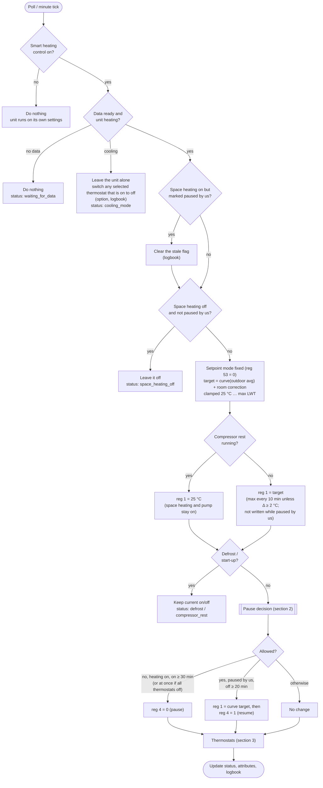
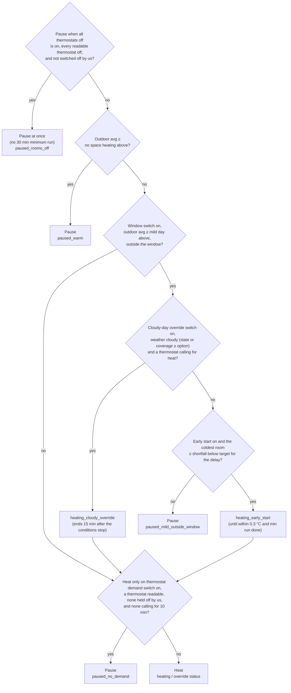
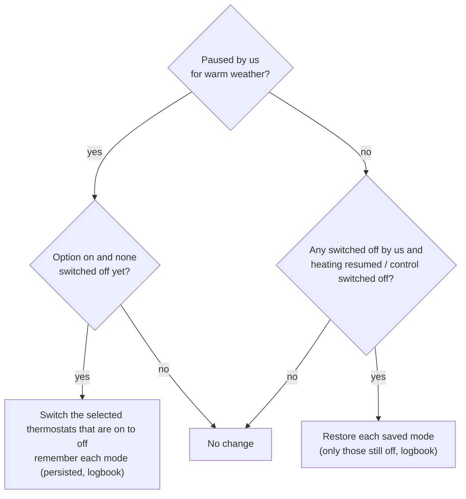
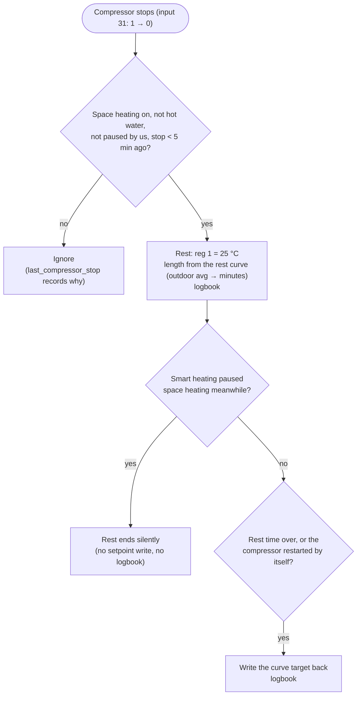

# Smart heating – logic

How the smart heating controller (`custom_components/daikin_dcom/smart.py`) decides what to do. It runs on every
poll (30 s by default) and at least once a minute. Nothing here acts unless **Smart heating control** is on.
Settings and switches are explained in the [README](../README.md#smart-heating-control-optional).

## 1. Each evaluation

## 2. Pause decision

Checked in this order; the first match wins. The **heat only on thermostat demand** check comes last and can only
turn "heat" into a pause, never the other way round. Thresholds use the outdoor temperature averaged over about an hour,
with 0.5 °C hysteresis.

## 3. Thermostats in warm weather

Only with the option **switch the selected thermostats off while heating is paused for warm weather**.

A warm pause that turns into a mild-day pause keeps them off until heating restarts.

## 4. Compressor rest

Runs alongside section 1 (option, on by default).

